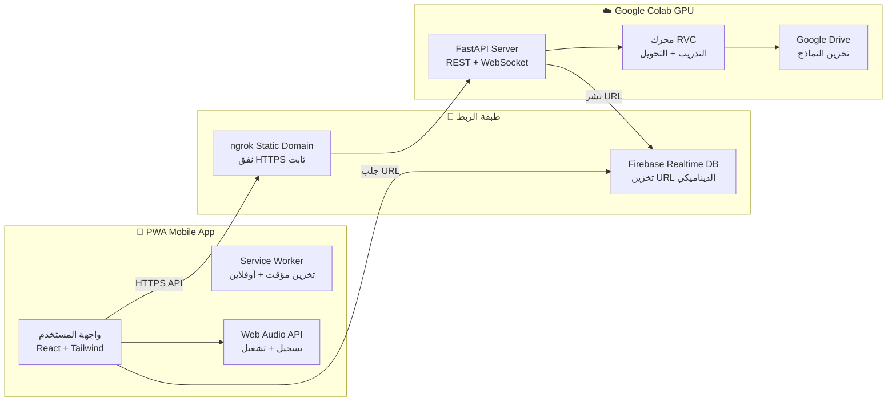
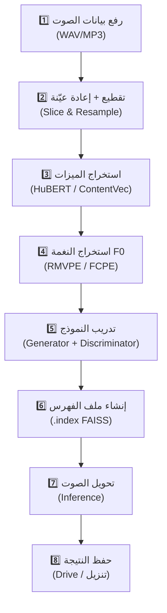
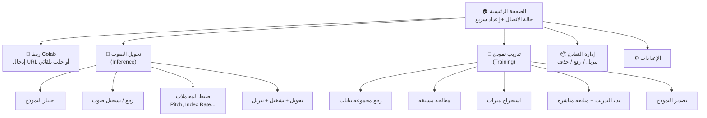
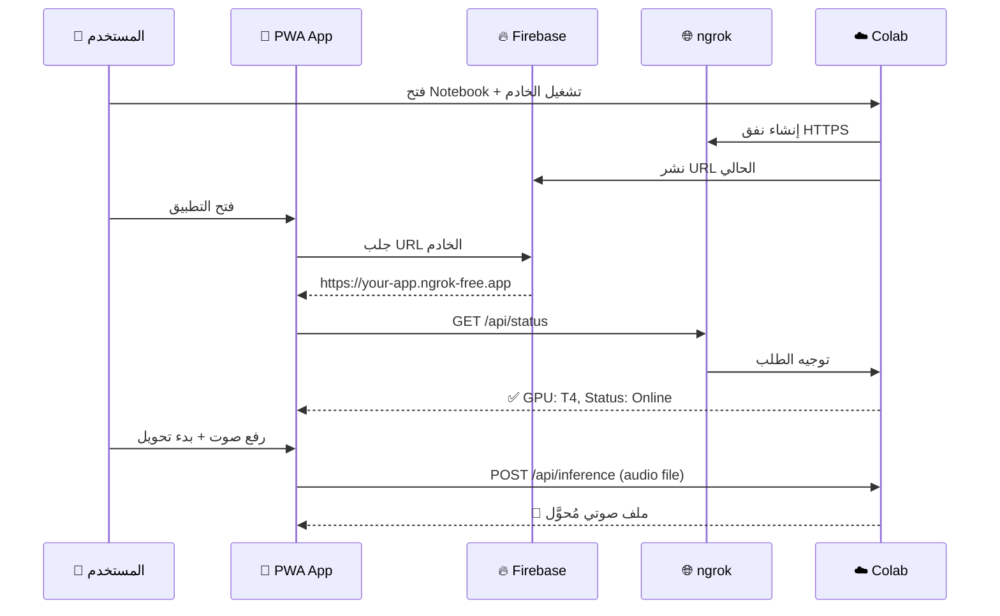
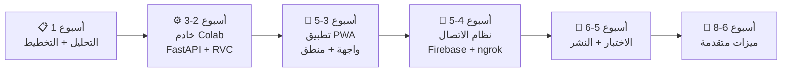

# 📱 خطة بناء تطبيق VoiceForge — بديل Applio للموبايل (PWA + Google Colab)

> [!IMPORTANT]
> هذه خطة شاملة لبناء تطبيق PWA يعمل كبديل موبايل لتطبيق Applio لاستنساخ الأصوات بالذكاء الاصطناعي، مرتبط بـ Google Colab كخادم GPU مجاني.

---

## 🏗️ نظرة عامة على المعمارية



---

## 📋 المرحلة الأولى: التحليل والتخطيط (أسبوع 1)

### 1.1 دراسة بنية Applio الداخلية

Applio مبني على معمارية **RVC v2 (Retrieval-based Voice Conversion)** ويتكون من:

| المكوّن | الملف/المجلد | الوظيفة |
|---------|-------------|---------|
| المحرك الأساسي | `rvc/infer/` | تحويل الصوت باستخدام النموذج المُدرَّب |
| التدريب | `rvc/train/` | تدريب نماذج الصوت الجديدة |
| استخراج الميزات | `rvc/lib/` | خوارزميات الـ Pitch (RMVPE, FCPE, Crepe) |
| الإعدادات | `rvc/configs/` | كشف GPU، معدلات العينات |
| واجهة CLI | `core.py` | نقطة الدخول البرمجية (بدون واجهة) |
| واجهة الويب | `app.py` + `tabs/` | Gradio UI |

### 1.2 خط سير المعالجة (Pipeline)



---

## 📋 المرحلة الثانية: بناء خادم Colab Backend (أسبوع 2-3)

### 2.1 إنشاء Notebook مخصص

بدلاً من استخدام Gradio UI الخاص بـ Applio، سنبني **FastAPI REST API** يعمل داخل Colab:

#### الخلايا المطلوبة في الـ Notebook:

**الخلية 1 — الإعداد والتثبيت:**
```python
# تركيب Google Drive
from google.colab import drive
drive.mount('/content/drive')

# استنساخ Applio
!git clone https://github.com/IAHispano/Applio.git /content/Applio
%cd /content/Applio
!pip install -r requirements.txt

# تثبيت مكتبات الخادم
!pip install fastapi uvicorn pyngrok nest-asyncio python-multipart aiofiles
```

**الخلية 2 — خادم FastAPI مع API Endpoints:**

| Endpoint | Method | الوظيفة |
|----------|--------|---------|
| `/api/status` | GET | حالة الخادم + معلومات GPU |
| `/api/models` | GET | قائمة النماذج المتاحة |
| `/api/upload-dataset` | POST | رفع ملفات صوتية للتدريب |
| `/api/preprocess` | POST | تقطيع وإعادة عيّنة البيانات |
| `/api/extract-features` | POST | استخراج الميزات الصوتية |
| `/api/train` | POST | بدء التدريب |
| `/api/train/status` | GET | WebSocket لمتابعة تقدم التدريب |
| `/api/inference` | POST | تحويل صوت واحد |
| `/api/download-model` | POST | تنزيل نموذج من الإنترنت |
| `/api/models/upload` | POST | رفع نموذج `.pth` + `.index` |

**الخلية 3 — نفق ngrok مع نطاق ثابت:**
```python
from pyngrok import ngrok
import requests

# استخدام النطاق الثابت المجاني
ngrok.set_auth_token("YOUR_TOKEN")
tunnel = ngrok.connect(8000, domain="your-app.ngrok-free.app")

# نشر URL في Firebase لربطه بالتطبيق
firebase_url = "https://YOUR-PROJECT.firebaseio.com"
requests.put(f"{firebase_url}/config/serverUrl.json",
             json=str(tunnel.public_url))
```

### 2.2 آلية الحفاظ على الاتصال (Keep-Alive)

```python
# منع Colab من قطع الجلسة
import IPython
js = '''<script>
  setInterval(() => {
    fetch('./').catch(() => {});
    document.querySelector('#top-toolbar .colab-run-button')?.click();
  }, 60000);
</script>'''
IPython.display.display(IPython.display.HTML(js))
```

> [!WARNING]
> **قيود Colab المجاني:**
> - أقصى مدة جلسة: ~12 ساعة
> - قد لا يتوفر GPU في أوقات الذروة
> - يتطلب إبقاء تبويب المتصفح مفتوحاً
> - يُنصح بحفظ النماذج في Google Drive بشكل دوري

---

## 📋 المرحلة الثالثة: بناء تطبيق PWA للموبايل (أسبوع 3-5)

### 3.1 التقنيات المستخدمة

| الطبقة | التقنية | السبب |
|--------|---------|-------|
| إطار العمل | **React 18+** أو **Vue 3** | مكوّنات تفاعلية + نظام بيئي غني |
| التنسيق | **Tailwind CSS** | تصميم متجاوب سريع |
| إدارة الحالة | **Zustand** أو **Pinia** | خفيف وبسيط |
| الصوت | **Web Audio API** + **Wavesurfer.js** | تسجيل + عرض موجي |
| الاتصال | **Fetch API** + **WebSocket** | REST + تحديثات مباشرة |
| التخزين | **IndexedDB** (via Dexie.js) | تخزين محلي للملفات المؤقتة |
| PWA | **Workbox** | Service Worker + تخزين مؤقت |
| الاستضافة | **GitHub Pages** / **Vercel** / **Netlify** | مجاني + HTTPS |

### 3.2 هيكل صفحات التطبيق



### 3.3 الشاشات الرئيسية

#### شاشة الاتصال (Connection)
- عرض حالة Colab (متصل / غير متصل / يبحث)
- جلب URL تلقائياً من Firebase
- خيار إدخال URL يدوياً
- عرض معلومات GPU المتاح
- زر "فتح Colab Notebook" لبدء الخادم

#### شاشة تحويل الصوت (Inference)
- قائمة منسدلة لاختيار النموذج (`.pth`) والفهرس (`.index`)
- زر تسجيل صوتي مباشر أو رفع ملف
- شريط تمرير لـ **Pitch Shift** (من -24 إلى +24)
- اختيار خوارزمية F0 (RMVPE, FCPE, Crepe)
- شريط تمرير لـ **Index Rate** (0.0 → 1.0)
- خيار حماية الحروف الساكنة
- عرض موجي للصوت الأصلي والمُحوَّل
- أزرار تشغيل وتنزيل

#### شاشة التدريب (Training)
- إدخال اسم التجربة
- رفع ملفات الصوت (سحب وإفلات)
- اختيار معدل العيّنة (32k, 40k, 48k)
- اختيار Embedder Model
- ضبط عدد الحقب (Epochs) + حجم الدفعة (Batch Size)
- **شريط تقدم مباشر** عبر WebSocket
- رسم بياني للخسارة (Loss Chart) بالوقت الفعلي
- زر إيقاف / استئناف التدريب

#### شاشة إدارة النماذج (Models)
- عرض النماذج المُدرَّبة والمُنزَّلة
- تنزيل نماذج من رابط مباشر أو Hugging Face
- رفع نماذج من الجهاز
- مشاركة / تصدير / حذف نماذج
- مزامنة مع Google Drive

### 3.4 إعداد PWA

```json
// manifest.json
{
  "name": "VoiceForge - AI Voice Cloning",
  "short_name": "VoiceForge",
  "description": "تحويل واستنساخ الأصوات بالذكاء الاصطناعي",
  "start_url": "/",
  "display": "standalone",
  "orientation": "portrait",
  "theme_color": "#6366f1",
  "background_color": "#0f172a",
  "icons": [
    { "src": "/icons/icon-192.png", "sizes": "192x192", "type": "image/png" },
    { "src": "/icons/icon-512.png", "sizes": "512x512", "type": "image/png" }
  ]
}
```

---

## 📋 المرحلة الرابعة: نظام الاتصال والمزامنة (أسبوع 4-5)

### 4.1 معمارية الاتصال



### 4.2 إدارة حالة الاتصال

```
حالات الاتصال:
├── 🟢 متصل (Connected) — الخادم يعمل والـ GPU متاح
├── 🟡 يتصل (Connecting) — جاري البحث عن الخادم
├── 🔴 غير متصل (Disconnected) — الخادم متوقف
└── ⚠️ بدون GPU (No GPU) — الخادم يعمل لكن بدون GPU
```

**آلية إعادة الاتصال التلقائي:**
1. محاولة الاتصال كل 10 ثوانٍ
2. الاستماع لتغييرات Firebase في الوقت الفعلي
3. إشعار المستخدم عند تغيّر الحالة
4. تخزين آخر URL ناجح محلياً كاحتياط

---

## 📋 المرحلة الخامسة: الاختبار والنشر (أسبوع 5-6)

### 5.1 الاختبار

| نوع الاختبار | الأداة | النطاق |
|-------------|-------|--------|
| وحدات | Vitest / Jest | منطق API + تحويل الصوت |
| تكامل | Playwright | سيناريوهات التحويل والتدريب |
| أداء | Lighthouse | نقاط PWA + سرعة التحميل |
| موبايل | Chrome DevTools | تجاوب + لمس |
| شبكة | يدوي | استقرار الاتصال مع Colab |

### 5.2 النشر

| المكوّن | مكان النشر | الملاحظة |
|---------|-----------|---------|
| PWA Frontend | **Vercel** أو **Netlify** | مجاني + HTTPS + CDN عالمي |
| Colab Notebook | **GitHub Repo** | يفتحه المستخدم في Colab |
| Firebase Config | **Firebase Free** | Spark Plan مجاني |
| النماذج المُدرَّبة | **Google Drive** | مرتبط بحساب المستخدم |

### 5.3 بنية المشروع النهائية

```
voiceforge/
├── frontend/                    # تطبيق PWA
│   ├── public/
│   │   ├── manifest.json
│   │   ├── sw.js
│   │   └── icons/
│   ├── src/
│   │   ├── components/
│   │   │   ├── AudioRecorder.jsx
│   │   │   ├── AudioPlayer.jsx
│   │   │   ├── WaveformDisplay.jsx
│   │   │   ├── ModelSelector.jsx
│   │   │   ├── TrainingProgress.jsx
│   │   │   ├── ConnectionStatus.jsx
│   │   │   └── ParameterSliders.jsx
│   │   ├── pages/
│   │   │   ├── Home.jsx
│   │   │   ├── Inference.jsx
│   │   │   ├── Training.jsx
│   │   │   ├── Models.jsx
│   │   │   └── Settings.jsx
│   │   ├── services/
│   │   │   ├── api.js            # اتصال REST مع Colab
│   │   │   ├── websocket.js      # اتصال WebSocket للتقدم المباشر
│   │   │   ├── firebase.js       # جلب URL الخادم
│   │   │   └── audio.js          # تسجيل + معالجة صوتية
│   │   ├── stores/
│   │   │   ├── connectionStore.js
│   │   │   ├── modelStore.js
│   │   │   └── audioStore.js
│   │   ├── App.jsx
│   │   └── main.jsx
│   ├── package.json
│   └── vite.config.js
│
├── colab/                       # ملفات Google Colab
│   ├── VoiceForge_Server.ipynb  # Notebook الخادم الرئيسي
│   ├── server/
│   │   ├── main.py              # FastAPI server
│   │   ├── routes/
│   │   │   ├── inference.py     # endpoints تحويل الصوت
│   │   │   ├── training.py      # endpoints التدريب
│   │   │   ├── models.py        # endpoints إدارة النماذج
│   │   │   └── status.py        # endpoints حالة الخادم
│   │   ├── services/
│   │   │   ├── rvc_engine.py    # غلاف لمحرك RVC
│   │   │   ├── audio_processor.py
│   │   │   └── drive_sync.py    # مزامنة Google Drive
│   │   └── config.py
│   └── requirements.txt
│
└── docs/                        # التوثيق
    ├── setup-guide.md
    ├── api-reference.md
    └── user-manual.md
```

---

## 📋 المرحلة السادسة: ميزات متقدمة (أسبوع 6-8)

### 6.1 ميزات إضافية مخطط لها

| الميزة | الوصف | الأولوية |
|--------|-------|---------|
| 🎵 TTS مدمج | تحويل نص إلى كلام باستخدام نموذج RVC | متوسطة |
| 🔀 دمج النماذج | دمج نموذجين لإنشاء صوت هجين | متوسطة |
| 📊 TensorBoard | عرض رسوم بيانية التدريب في التطبيق | عالية |
| 🌐 مجتمع النماذج | تصفح وتنزيل نماذج مجتمعية | منخفضة |
| 🎛️ فصل الأصوات | فصل الصوت عن الموسيقى (UVR5) | متوسطة |
| 📱 إشعارات | إشعار عند انتهاء التدريب/التحويل | عالية |
| 🔄 Batch Processing | تحويل عدة ملفات دفعة واحدة | متوسطة |

### 6.2 تحسينات الأداء

- **ضغط الصوت** قبل الإرسال (Opus/AAC) لتقليل استهلاك البيانات
- **تخزين مؤقت للنماذج** في IndexedDB لتسريع إعادة الاستخدام
- **تحميل كسول** (Lazy Loading) للصفحات والمكوّنات
- **Web Workers** لمعالجة الصوت في خيط منفصل

---

## ⏱️ الجدول الزمني الكامل



---

## ⚠️ تحديات ومخاطر

> [!CAUTION]
> ### مخاطر يجب الانتباه لها:
> 
> 1. **انقطاع جلسة Colab** — الحل: حفظ تلقائي دوري في Drive + إشعار المستخدم
> 2. **عدم توفر GPU** — الحل: رسالة واضحة + دعم CPU كبديل بطيء
> 3. **حجم الملفات الكبير** — الحل: ضغط + رفع مجزأ (Chunked Upload)
> 4. **أمان API** — الحل: مفتاح API بسيط يُنشأ عند بدء الخادم
> 5. **تغييرات Applio المستقبلية** — الحل: غلاف (Wrapper) مستقل عن إصدار محدد
> 6. **سياسات Google** — الاستخدام ضمن الحدود المسموحة لـ Colab المجاني

---

## 🛠️ متطلبات البدء

> [!TIP]
> ### ما تحتاجه للبدء:
> 
> 1. **حساب Google** — لـ Colab + Drive
> 2. **حساب ngrok مجاني** — للحصول على نطاق ثابت
> 3. **مشروع Firebase** — للربط الديناميكي (Spark المجاني يكفي)
> 4. **حساب Vercel/Netlify** — لاستضافة PWA مجاناً
> 5. **Node.js 18+** — لتطوير الواجهة محلياً
> 6. **معرفة أساسية بـ** React/Vue + Python + FastAPI

---

## ✅ خطوات البدء الفوري

1. ☐ إنشاء مستودع GitHub للمشروع
2. ☐ إعداد مشروع React + Vite + Tailwind
3. ☐ إنشاء حساب ngrok + الحصول على نطاق ثابت
4. ☐ إعداد مشروع Firebase
5. ☐ بناء Colab Notebook مع FastAPI
6. ☐ ربط أول endpoint (`/api/status`)
7. ☐ بناء شاشة الاتصال في PWA
8. ☐ تنفيذ تحويل الصوت (Inference) end-to-end
9. ☐ تنفيذ التدريب (Training) end-to-end
10. ☐ نشر PWA + اختبار على الموبايل
